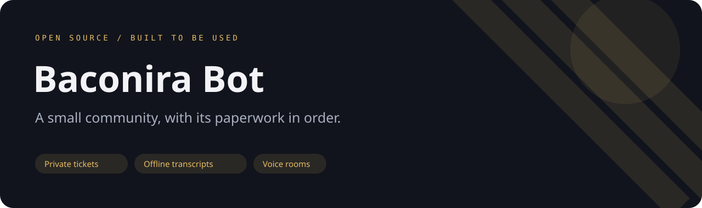
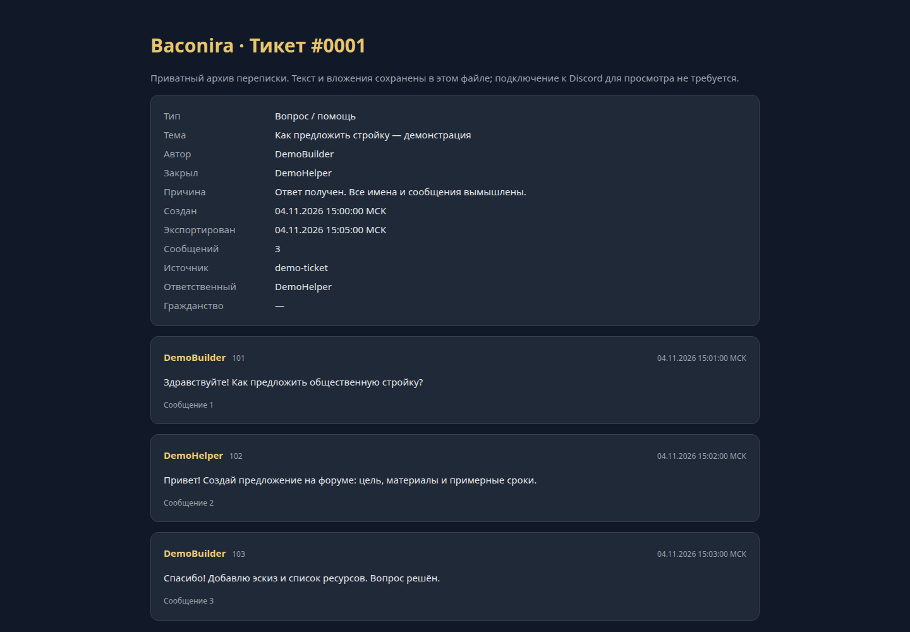

**English** · [Русский](README.ru.md)



# Baconira Bot

A Discord community bot for private support tickets, citizenship applications, proposals and temporary voice rooms.

[](https://github.com/ari3lYT/baconira-bot/actions/workflows/ci.yml)
[](LICENSE)

[Quick start](#quick-start) · [Architecture](docs/architecture.md) · [Development](docs/development.md)


## See it



## Features

- Private tickets with one active case per member, assignment, close reasons and restart recovery.
- Offline HTML transcripts with copied attachments and a SHA-256 manifest; source channels are
  removed only after archive upload is confirmed.
- Citizenship applications, restricted staff channels and repeatable role/channel setup.
- Native forum proposals, voting and staff decisions.
- Owner-controlled temporary voice rooms, welcome cards and event logs.

## Quick start

Python 3.10+ and a **Discord bot account** are required.

```bash
python3 -m venv .venv
. .venv/bin/activate
pip install -r requirements.txt
export DISCORD_GUILD_ID=your_server_id
python bot.py
```

The bot prompts for its token without echo, or reads `DISCORD_BOT_TOKEN` / a local `.token` file.
Enable Server Members and Message Content intents in the Discord Developer Portal. Invite the bot
with the permissions in [configuration](docs/configuration.md), place its role above the roles it manages,
then run `/настроить` as a server administrator. The explicit server ID prevents configuring another guild.

Branding PNGs are optional. No real server IDs, member lists, tickets, transcripts or bot token are included.

## Development

```bash
python -m unittest discover -s tests -v
```

The Russian community layout is intentional. Edit `ROLE_SPECS`, `STAFF`, `SENATE`, `LAYOUT` in `bot.py`
and presentation dictionaries in `features.py` to adapt the theme; see the [developer guide](docs/development.md).

[Release verification and limits](docs/verification.md) · [Changelog](CHANGELOG.md)
