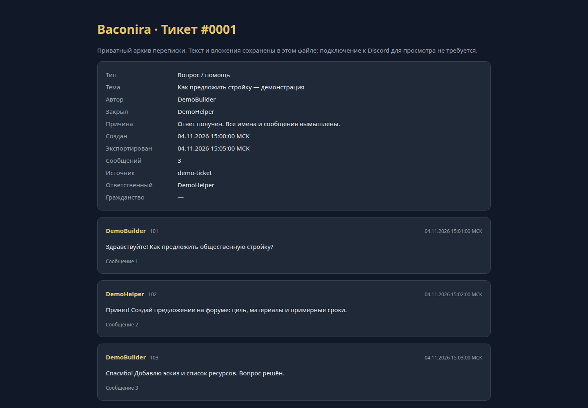

[English](README.md) · **Русский**


# Baconira Bot

Discord-бот для сообщества: приватные обращения, заявки на гражданство, предложения и временные голосовые комнаты.

[](https://github.com/ari3lYT/baconira-bot/actions/workflows/ci.yml)
[](LICENSE)

[Быстрый старт](#быстрый-старт) · [Архитектура](docs/architecture.ru.md) · [Разработка](docs/development.ru.md)

## Скриншот



## Возможности

- Приватные обращения: одно активное дело на участника, назначение ответственного, причина закрытия и восстановление после перезапуска.
- Автономные HTML-расшифровки с копиями вложений и манифестом SHA-256; исходный канал удаляется только после подтверждённой загрузки архива.
- Заявки на гражданство, закрытые каналы сотрудников и повторяемая настройка ролей и каналов.
- Предложения в нативных форумах Discord, голосования и решения сотрудников.
- Временные голосовые комнаты с управлением владельцем, приветственные карточки и журнал событий.

## Быстрый старт

Нужны Python 3.10+ и **учётная запись Discord-бота**.

```bash
python3 -m venv .venv
. .venv/bin/activate
pip install -r requirements.txt
export DISCORD_GUILD_ID=your_server_id
python bot.py
```

Бот запрашивает токен без отображения ввода либо читает `DISCORD_BOT_TOKEN` / локальный файл `.token`. В Discord Developer Portal включите Server Members и Message Content intents. Пригласите бота с правами из [настроек](docs/configuration.ru.md), разместите его роль выше управляемых ролей и выполните `/настроить` от имени администратора сервера. Явный ID сервера защищает от настройки другого сообщества.

PNG-изображения оформления необязательны. Репозиторий не содержит реальных ID серверов, списков участников, обращений, переписок или токена бота.

## Разработка

```bash
python -m unittest discover -s tests -v
```

Русскоязычная структура сообщества выбрана намеренно. Для своей тематики измените `ROLE_SPECS`, `STAFF`, `SENATE`, `LAYOUT` в `bot.py` и словари оформления в `features.py`; см. [руководство разработчика](docs/development.ru.md).

[Проверки релиза и их границы](docs/verification.ru.md) · [История изменений](CHANGELOG.ru.md)
