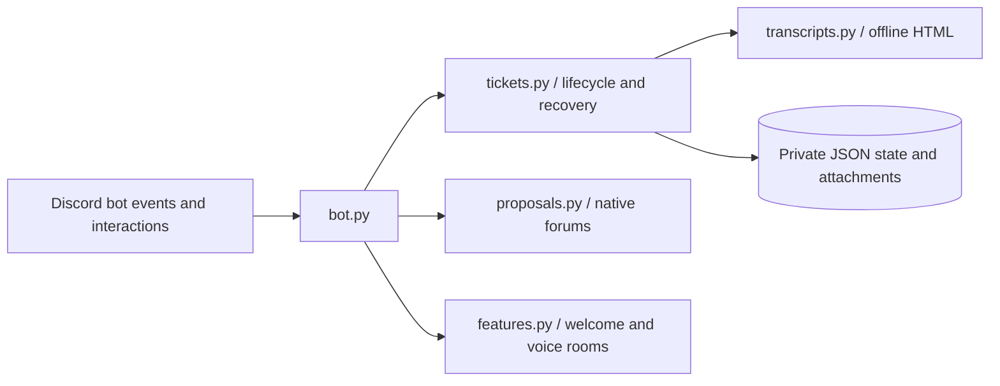

**English** · [Русский](architecture.ru.md)

# Architecture

Each guild has persisted state. Operations use per-guild asynchronous locks to prevent double submits,
duplicate active cases and concurrent closure. A ticket passes through an archival state before deletion.
Transcript bytes and attachments are saved locally and a manifest describes uploaded parts and checksums.
An unsuccessful export/upload leaves the source channel intact for retry.

The bot archives ticket conversations, not ordinary community chats. Discord administrators and the
server owner can bypass channel permission overwrites; document that fact to your community.
