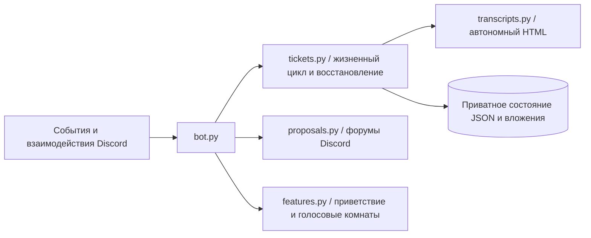

[English](architecture.md) · **Русский**

# Архитектура

Для каждого сервера сохраняется собственное состояние. Асинхронные блокировки на уровне сервера защищают от повторной отправки, нескольких активных дел одного участника и одновременного закрытия. Перед удалением обращение проходит стадию архивирования. HTML и вложения сохраняются локально; манифест описывает загруженные части и контрольные суммы. При неудачном экспорте или загрузке исходный канал сохраняется для повторной попытки.

Бот архивирует переписку обращений. Обычные чаты сообщества не архивируются. Администраторы Discord и владелец сервера могут обходить переопределения прав канала; сообщите об этом участникам сообщества.
